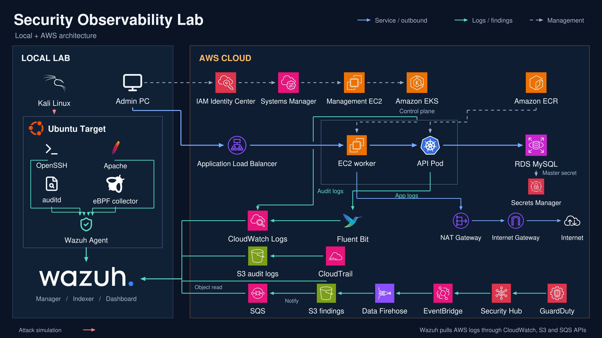

# 🛡️ Pathfinder Security Observability

> **Local + AWS Security Observability Lab**  
> Linux Host · eBPF · Kubernetes · AWS · Wazuh를 하나의 보안 관측 흐름으로 연결한 Security Engineering 프로젝트

<p align="center">
  
</p>

<p align="center"><b>Attack → Telemetry → Detection → Investigation</b></p>

<p align="center">
  
  
  
  
  
  
</p>

---

## Overview

**Pathfinder Security Observability**는 로컬 Linux Lab과 AWS Cloud에서 발생하는 보안 이벤트를 수집하고, **Wazuh를 중심으로 탐지·분석할 수 있는 하이브리드 보안 관측 환경**을 직접 설계하고 구축한 프로젝트입니다.

이 프로젝트의 목적은 단순히 AWS 리소스를 배포하거나 로그를 저장하는 것이 아닙니다.

> **공격이나 관리 행위가 발생했을 때, 시스템의 어느 계층에서 어떤 흔적이 생성되고 그 흔적을 어떻게 수집·연결·분석하여 보안 정보로 만들 수 있는가?**

```text
Attack / Activity
       ↓
Telemetry Generation
       ↓
Collection
       ↓
Normalization
       ↓
Detection
       ↓
Investigation
       ↓
Response / Re-validation
```

---

## Project Scope

| 영역 | 주요 대상 | 목적 |
|---|---|---|
| **Host Security** | Ubuntu, OpenSSH, Apache, auditd | 인증·웹·OS 이벤트 수집 |
| **Runtime Security** | eBPF / BCC | Process / File 활동 관측 |
| **Kubernetes Security** | EKS API Server Audit Log | kubectl / RBAC / API 활동 분석 |
| **Cloud Security** | CloudTrail, GuardDuty, Security Hub | AWS Control Plane 및 Finding 수집 |

중앙 분석 계층은 **Wazuh Manager / Indexer / Dashboard**로 구성했습니다.

---

# Architecture Design

전체 시스템은 세 개의 논리 Plane으로 나눴습니다.

### 1. Attack Plane

```text
Kali Linux
 ├─ Nmap
 ├─ Burp Suite
 ├─ ffuf
 └─ Gobuster
       │
       ▼
Ubuntu Target
```

공격 테스트는 개인 Lab 내부에서만 수행합니다.

### 2. Management Plane

```text
Admin PC
   │
   ▼
IAM Identity Center
   │
   ▼
Systems Manager
   │
   ▼
Private Management EC2
   │
   ▼
Private EKS API
```

- Public IP 없음
- SSH inbound 없음
- SSM Session Manager 사용
- HTTPS outbound만 허용
- EKS 관리 권한은 별도 IAM 권한으로 분리

### 3. Telemetry / Detection Plane

```text
Host Logs ────────────────┐
eBPF Runtime Events ──────┤
CloudTrail ───────────────┤
EKS Audit Logs ───────────┤──▶ Wazuh
Application Logs ─────────┤
Security Hub Findings ────┘
```

---

# Local Security Lab

```text
192.168.100.0/24

Kali Linux
192.168.100.10
      │
      │ Attack
      ▼
Ubuntu Target
192.168.100.20
      │
      ├─ OpenSSH
      ├─ Apache
      ├─ auditd
      ├─ eBPF / BCC
      └─ Wazuh Agent
              │
              ▼
         Wazuh SIEM
```

| Telemetry | Source |
|---|---|
| Authentication | `auth.log` |
| Web | Apache access/error logs |
| OS Audit | `auditd` |
| Process / File | eBPF / BCC |
| Agent Collection | Wazuh Agent |

---

# Runtime Security with eBPF

Kernel 수준의 활동을 관찰하기 위해 BCC/eBPF 환경을 구성했습니다.

```bash
execsnoop-bpfcc
opensnoop-bpfcc
```

설계한 Runtime Telemetry 흐름:

```text
Application / Process
        │
      syscall
        │
        ▼
   Linux Kernel
        │
        ▼
      eBPF
        │
        ▼
 Python Collector
        │
        ▼
    JSON Event
        │
        ▼
   Wazuh Agent
        │
        ▼
      Wazuh
```

```text
execve  → Process Execution
openat  → File Access
connect → Network Connection
```

---

# AWS Infrastructure

```text
infra/
├── bootstrap/
├── network/
├── management/
├── eks/
├── ecr/
├── ingress/
├── rds/
├── logging/
└── security/
```

| Stack | Responsibility |
|---|---|
| `bootstrap` | Terraform Remote State S3 |
| `network` | VPC / Subnet / Route Table / IGW |
| `management` | Private Management EC2 / SSM / NAT |
| `eks` | Private EKS / Node Group |
| `ecr` | Container Image Repository |
| `ingress` | AWS Load Balancer Controller / IRSA |
| `rds` | MySQL RDS |
| `logging` | CloudTrail / CloudWatch / Wazuh IAM |
| `security` | GuardDuty / Security Hub / Findings Pipeline |

Terraform state 역시 Stack별 S3 key로 분리했습니다.

---

## Network Design

```text
VPC 10.20.0.0/16

├── Public
│   ├── 10.20.1.0/24  ap-northeast-2a
│   └── 10.20.2.0/24  ap-northeast-2c
├── Private App
│   ├── 10.20.11.0/24 ap-northeast-2a
│   └── 10.20.12.0/24 ap-northeast-2c
└── Private DB
    ├── 10.20.21.0/24 ap-northeast-2a
    └── 10.20.22.0/24 ap-northeast-2c
```

- ALB / NAT Gateway → Public
- EKS Worker / Management EC2 → Private App
- RDS → Private DB
- EC2 Public IPv4 자동 할당 비활성화
- DB Subnet에 Internet Default Route 미구성
- 실제 접근 제어는 Security Group으로 제한

---

# Amazon EKS

EKS API Endpoint는 **Private**로 구성했습니다.

```text
Private EKS
   │
   ├─ Managed Node Group
   ├─ Flask API Pod
   ├─ Fluent Bit
   └─ AWS Load Balancer Controller
```

Kubernetes 관리 명령은 Management EC2에서 수행합니다.

## Container Hardening

```yaml
automountServiceAccountToken: false

securityContext:
  runAsNonRoot: true
  seccompProfile:
    type: RuntimeDefault
```

```yaml
allowPrivilegeEscalation: false
readOnlyRootFilesystem: true
capabilities:
  drop:
    - ALL
```

추가 적용 항목:

- CPU / Memory request & limit
- startupProbe / readinessProbe / livenessProbe
- tmpfs 기반 writable path 분리

---

# Container Supply Path

```text
Application Source
      │
      ▼
Docker Build
      │
      ▼
Amazon ECR
      │
      ▼
Amazon EKS
```

ECR 설정:

- `IMMUTABLE` Image Tag
- AES256 Encryption
- `scan_on_push`
- Image Digest 기반 Deployment 검증

---

# Observable Flask API

| Endpoint | Purpose |
|---|---|
| `/` | Service / Version |
| `/healthz` | Health Check |
| `/api/info` | App / DB Configuration |
| `/api/db` | RDS Data Query |

Application Event는 JSON Structured Log로 기록합니다.

```json
{
  "service": "security-lab-api",
  "version": "0.2.0",
  "event": "http_request",
  "request_id": "e71d5efe-...",
  "method": "GET",
  "path": "/api/db",
  "status": 200
}
```

`request_id`로 HTTP 요청과 DB 이벤트를 연결합니다.

```text
HTTP Request
    │
    ├─ http_request
    └─ db_query / db_error
```

---

# RDS Security

Amazon RDS MySQL 8.4를 사용했습니다.

- Private DB Subnet
- Public Access Disabled
- Encrypted gp3
- TCP 3306 Security Group 제한
- RDS-managed Master Password
- Deletion Protection

DB 연결은 `VERIFY_IDENTITY` 방식으로 검증했습니다.

```text
TLS Encryption
+ CA Certificate Validation
+ Database Hostname Validation
```

Application 계정은 Master 계정과 분리하고 특정 Table의 `SELECT` 권한만 부여했습니다.

```text
SELECT → Allowed
UPDATE → Denied
```

---

# Application Log Pipeline

```text
Flask API
   │
   ▼
Container Log
   │
   ▼
Fluent Bit
   │
   ▼
CloudWatch Logs
   │
   ▼
Wazuh
```

CloudWatch Log Group:

```text
/security-lab/eks/security-lab-api
```

Retention: **7 days**

Fluent Bit은 전용 ServiceAccount + IRSA Role을 사용합니다.

---

# Wazuh Application Detection Rules

| Rule ID | Detection | Level |
|---|---|---:|
| `110300` | API Log Parent | 0 |
| `110301` | HTTP Request | 3 |
| `110302` | HTTP 4xx | 5 |
| `110303` | HTTP 5xx | 8 |
| `110304` | DB Error | 8 |
| `110305` | DB Query Success | 3 |

Wazuh Dashboard에서 실제 Rule Firing까지 검증했습니다.

---

# AWS Control Plane Monitoring

```text
AWS API
   │
   ▼
CloudTrail
   │
   ▼
S3
   │
   ▼
Wazuh
```

CloudTrail 설정:

- Multi-Region
- Global Service Events
- Read / Write Management Events
- Log File Validation
- S3 Lifecycle

Local Wazuh가 AWS 로그를 Pull하므로 Wazuh 자체를 AWS 측에 공개할 필요가 없습니다.

---

# Detection Validation — IAM AccessDenied

```text
security-lab-wazuh-reader
        │
        │ iam:ListUsers
        ▼
       AWS
        │
        ▼
   AccessDenied
        │
        ▼
    CloudTrail
        │
        ▼
      Wazuh
```

Wazuh에서 확인한 핵심 필드:

```text
data.aws.eventName              = ListUsers
data.aws.errorCode              = AccessDenied
data.aws.userIdentity.userName  = security-lab-wazuh-reader
data.aws.requestID              = generated request ID
```

---

# Kubernetes Audit Monitoring

```text
CloudTrail     → AWS API Activity
EKS Audit Log  → Kubernetes API Activity
```

```text
kubectl
   │
   ▼
EKS API Server
   │
   ▼
Audit Log
   │
   ▼
CloudWatch Logs
   │
   ▼
Wazuh
```

Custom Wazuh Rule:

```text
110100 → Kubernetes Audit Parent Rule
110101 → 특정 Deployment GET 성공 이벤트
```

향후 Detection 확장 대상:

```text
pods/exec
pods/create
secrets/get
roles/create
rolebindings/create
privileged workload
```

---

# AWS Native Threat Detection

```text
GuardDuty
    │
    ▼
Security Hub
```

GuardDuty Finding을 Security Hub에 집계하고 Wazuh로 전달합니다.

---

# Security Finding Pipeline

```text
GuardDuty
    │
    ▼
Security Hub
    │
    ▼
EventBridge
    │
    ▼
Amazon Data Firehose
    │
    ▼
S3 Findings
    │
    ├──────────▶ Wazuh
    │
    ▼
SQS
```

| Component | Role |
|---|---|
| GuardDuty | AWS Threat Detection |
| Security Hub | Finding Aggregation |
| EventBridge | Finding Filtering / Routing |
| Data Firehose | Finding Delivery |
| S3 | Finding Storage |
| SQS | Object-created Notification |
| Wazuh | SIEM Ingestion / Investigation |

SQS는 로그 본문 저장소가 아니라 **S3에 새로운 Finding Object가 생성되었음을 알려주는 Notification Queue**로 사용합니다.

---

# Validation Status

| Area | Status | Validation |
|---|---|---|
| Local Attack Lab | ✅ | Kali / Ubuntu / Wazuh |
| Wazuh Agent | ✅ | Target → Manager |
| auditd | ✅ | Host Audit |
| eBPF / BCC | ✅ Base | Process / File Event |
| Terraform Remote State | ✅ | S3 Backend / Lock |
| AWS Network | ✅ | VPC / 6 Subnet / Routing |
| Management Plane | ✅ | Private EC2 / SSM |
| EKS | ✅ | Private API / Node Group |
| Flask API | ✅ | JSON Structured Logging |
| ECR | ✅ | Build / Push / Digest |
| ALB / Ingress | ✅ | External Access |
| RDS | ✅ | TLS / Least Privilege |
| CloudTrail → Wazuh | ✅ | AWS API Event |
| IAM AccessDenied | ✅ | Detection Validation |
| EKS Audit → Wazuh | ✅ | Custom Rule |
| App Log → Wazuh | ✅ | HTTP / DB Rules |
| GuardDuty / Security Hub | ✅ | Finding Aggregation |
| Findings → Wazuh | ✅ | Firehose / S3 / SQS |
| Full Attack Scenarios | 🚧 | Detection Engineering Expansion |

---

# Detection Engineering Roadmap

### Host

```text
SSH Brute Force
Web Enumeration
Suspicious Process Execution
Sensitive File Access
Suspicious Network Connection
```

### Kubernetes

```text
pods/exec
Secret Access
Privileged Pod
RBAC Modification
RoleBinding Creation
```

### AWS

```text
IAM Permission Modification
Security Group Modification
Unauthorized API Call
Suspicious GuardDuty Finding
```

각 시나리오는 다음 흐름으로 기록하는 것을 목표로 합니다.

```text
Attack
  ↓
Telemetry
  ↓
Detection Evidence
  ↓
Investigation
  ↓
Response
  ↓
Re-validation
```

---

# Repository Structure

```text
security-observability-lab/
│
├── app/
│   ├── app.py
│   ├── requirements.txt
│   └── Dockerfile
│
├── infra/
│   ├── bootstrap/
│   ├── network/
│   ├── management/
│   ├── eks/
│   ├── ecr/
│   ├── ingress/
│   ├── rds/
│   ├── logging/
│   └── security/
│
├── k8s/
│   ├── security-lab-api.yaml
│   └── app-log-collector.yaml
│
├── assets/
│   └── Local_AWS_Architecture.png
│
├── .gitignore
└── README.md
```

---

# Deployment Flow

```text
bootstrap
    ↓
network
    ↓
management
    ↓
eks
    ↓
ecr
    ↓
ingress
    ↓
rds
    ↓
logging
    ↓
security
```

## Requirements

```text
Terraform >= 1.10
AWS CLI v2
Docker
kubectl
AWS IAM Identity Center / CLI Profile
```

계정 정보와 Secret은 Repository에 저장하지 않습니다.

```bash
cp infra/backend.hcl.example infra/backend.hcl
```

```bash
for d in infra/*/; do
  cp "$d/terraform.tfvars.example" "$d/terraform.tfvars"
done
```

---

# Infrastructure Lifecycle & Teardown

이 프로젝트에서는 **구축뿐 아니라 전체 Teardown까지 직접 수행했습니다.**

```text
ingress
   ↓
eks
   ↓
rds
   ↓
ecr
   ↓
logging
   ↓
security
   ↓
management
   ↓
network
   ↓
bootstrap
```

Teardown 과정에서 `VPC DependencyViolation`을 실제로 경험했고, Kubernetes / AWS Load Balancer Controller가 생성한 잔여 리소스를 추적했습니다.

```text
terraform destroy
       ↓
VPC DependencyViolation
       ↓
ENI / Security Group Investigation
       ↓
Residual Kubernetes Security Group
       ↓
Security Group Rule Reference 분석
       ↓
Rule 제거
       ↓
Security Group 제거
       ↓
VPC Destroy
```

확인한 대표 잔여 리소스:

```text
Kubernetes-created Security Group
EKS Cluster Security Group
TargetGroupBinding Security Group Rule
```

> **Terraform State가 실제 Cloud Infrastructure 전체를 의미하지는 않는다.**

Managed Service와 Kubernetes Controller가 동적으로 생성한 리소스까지 이해해야 완전한 Lifecycle 관리가 가능합니다.

---

# Security Design Principles

### Minimize Public Exposure

```text
EKS API        → Private
Management EC2 → No Public IP
SSH            → No Inbound
RDS            → No Public Access
Wazuh          → No AWS-facing Inbound
```

### Least Privilege

```text
Management Role
Node Role
Load Balancer Controller Role
Application Log Collector Role
Wazuh Read-only User
Application DB User
```

### Workload Hardening

```text
RunAsNonRoot
ReadOnlyRootFilesystem
Drop ALL Capabilities
No Privilege Escalation
Seccomp RuntimeDefault
Immutable ECR Tags
```

### Credential / State Protection

```text
.tfstate
.tfvars
.env
credentials
secrets
```

위 정보는 Git에 저장하지 않습니다.

---

# Engineering Lessons

### 1. Observability is designed before the SIEM

```text
Telemetry Source
      ↓
Collection
      ↓
Transport
      ↓
Parsing
      ↓
Detection Rule
      ↓
Investigation
```

### 2. Logging and Detection are different layers

로그가 CloudWatch나 S3에 존재하는 것과 SIEM이 해당 이벤트를 **의미 있는 보안 이벤트로 판단하는 것**은 별개의 문제입니다.

### 3. Security context requires multiple layers

```text
ALB
 ↓
Kubernetes Service
 ↓
Application
 ↓
Database
```

하나의 행위가 Application Log, Kubernetes Audit, AWS API Log, Database Event에 서로 다르게 표현될 수 있습니다.

### 4. Least privilege must be verified

```text
허용 작업 → 성공
비허용 작업 → 실패
실패 이벤트 → SIEM에서 관측
```

### 5. IaC includes destruction

```text
Create
Read
Update
Destroy
```

---

# Tech Stack

| Domain | Technology |
|---|---|
| Cloud | AWS |
| Infrastructure as Code | Terraform |
| Identity | IAM Identity Center |
| Network | VPC / SG / NAT / ALB |
| Container | Docker |
| Registry | Amazon ECR |
| Orchestration | Kubernetes / Amazon EKS |
| Application | Python / Flask / Gunicorn |
| Database | Amazon RDS MySQL |
| Log Collector | Fluent Bit |
| SIEM / XDR | Wazuh |
| Host Audit | auditd |
| Runtime Observability | eBPF / BCC |
| AWS Audit | CloudTrail |
| Threat Detection | GuardDuty |
| Finding Aggregation | Security Hub |
| Event Routing | EventBridge |
| Delivery | Amazon Data Firehose |
| Storage | Amazon S3 |
| Messaging | Amazon SQS |
| Administration | AWS Systems Manager |

---

# Engineering Journal

프로젝트의 설계와 구축 과정은 기술 블로그에 단계별로 기록했습니다.

- [CH 01 — 목표, 요구사항 명세, 시나리오](https://blog.naver.com/pathfinder7777/224415382990)
- [CH 05 — AWS 인프라 구성 초안](https://blog.naver.com/pathfinder7777/224425949509)
- [CH 06 — Terraform 기반 AWS 인프라 구축 (1)](https://blog.naver.com/pathfinder7777/224426506114)
- [CH 07 — Terraform 기반 AWS 인프라 구축 (2)](https://blog.naver.com/pathfinder7777/224427445005)
- [CH 08 — Terraform 기반 AWS 인프라 구축 (3)](https://blog.naver.com/pathfinder7777/224428808243)
- [CH 09 — RDS / Security Findings / Application Logging](https://blog.naver.com/pathfinder7777/224431482149)

📚 [전체 기술 블로그](https://blog.naver.com/pathfinder7777)

---

# Lab Scope

이 Repository는 Production SOC Platform이 아니라 **Security Engineering 학습 및 검증을 위한 개인 Lab**입니다.

비용 절감을 위해 일부 구성은 의도적으로 단순화했습니다.

- EKS Worker Node 1대
- RDS Single-AZ
- NAT Gateway 1개
- 짧은 Log Retention
- 실습 종료 후 AWS Resource Teardown

Production 환경에서는 High Availability, Multi-AZ, Backup/DR, Secrets Rotation, Multi-Account Architecture, Long-term Log Retention, Automated Incident Response 등을 추가로 고려해야 합니다.

---

# Ethical Use

공격 및 침투 테스트는 소유하거나 명시적으로 허가받은 시스템에서만 수행합니다.

이 프로젝트의 공격 시나리오는 모두 **격리된 개인 Lab 환경의 탐지·분석 검증**을 목적으로 합니다.

---

# Author

**Changho Kim**

Security Engineering · Cloud · Linux · Kubernetes · Detection Engineering

- GitHub: https://github.com/path0971
- Tech Blog: https://blog.naver.com/pathfinder7777

---

## Final Goal

> **공격이나 관리 행위가 발생했을 때, 시스템의 어느 계층에서 어떤 흔적이 생성되고 그 흔적을 어떻게 수집·연결·분석하여 대응 가능한 보안 정보로 만들 것인가?**

```text
Attack
   ↓
Telemetry
   ↓
Context
   ↓
Detection
   ↓
Investigation
   ↓
Response
```

이를 직접 설계하고 구축하며 검증하는 것이 **Pathfinder Security Observability**의 목표입니다.
